# CodePet AI 🐾

A cute coding companion that lives inside **VS Code**. It watches your code for errors, explains them in simple words, fixes them with one click, and can write code for you from a short prompt. It works with many **free AI providers** (Groq, Gemini, Ollama and more).

> This README explains **how the project works, what every file does, and which piece of code makes each feature work.** Line numbers are approximate and may shift a little as the code changes.

---

## Table of Contents

1. [What is in this project?](#1-what-is-in-this-project)
2. [Big picture diagram](#2-big-picture-diagram)
3. [Folder and file guide](#3-folder-and-file-guide)
4. [Flow charts (how things work)](#4-flow-charts-how-things-work)
5. [Feature → File → Code map](#5-feature--file--code-map)
6. [Settings you can change](#6-settings-you-can-change)
7. [Database design](#7-database-design)
8. [How to run the project](#8-how-to-run-the-project)
9. [Security notes](#9-security-notes)
10. [Honest status: what is finished and what is not](#10-honest-status-what-is-finished-and-what-is-not)

---

## 1. What is in this project?

The project is a **monorepo** (one repository, three small apps, managed by npm workspaces):

| App | Folder | Tech | What it is for |
|---|---|---|---|
| **VS Code Extension** | `apps/vscode-extension` | TypeScript, VS Code API | The **main product**. The pet, error scanning, explain, fix, code generation. |
| **Backend API** | `apps/server` | Node.js, Express, Zod | A small optional server that talks to AI providers. Also holds starter learning content. |
| **Website** | `apps/web` | React, Vite, Framer Motion | A landing page where people download the `.vsix` file and read install steps. |

Support folders: `prisma/` (database design), `docker/` and `docker-compose.yml` (MySQL and a Swift runner image), `.vscode/` (press F5 to debug the extension).

**Important:** the extension works **on its own**. It does not need the backend server unless you choose the `backend` AI provider.

---

## 2. Big picture diagram

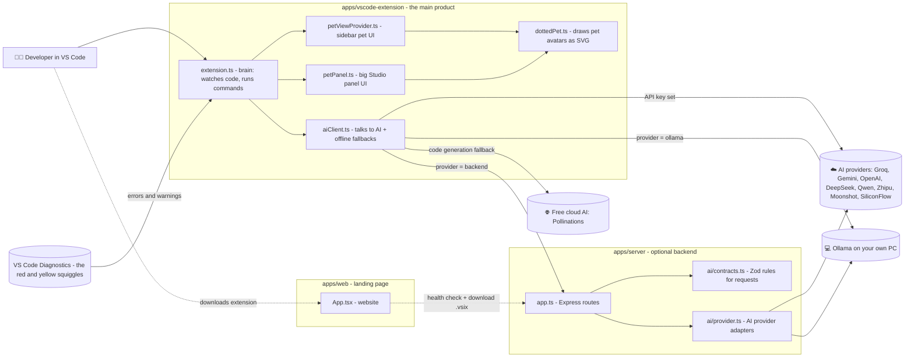

---

## 3. Folder and file guide

### 3.1 Folder tree

```text
aicodingpet/
├── package.json              # Root: npm workspaces + scripts (dev, build, test, db:*)
├── package-lock.json         # Exact dependency versions (auto-generated)
├── .env.example              # Template for the server's secret settings
├── .gitignore                # Files Git should ignore
├── docker-compose.yml        # Starts a MySQL 8.4 database
├── SECURITY.md               # Security rules for the project
├── test_sample.ts            # Tiny scratch file for testing the scanner
├── .vscode/                  # F5 debug setup
│   ├── launch.json
│   ├── tasks.json
│   └── extensions.json
├── docker/swift-runner/      # Safe sandbox image to compile Swift (not wired in yet)
│   ├── Dockerfile
│   └── README.md
├── prisma/                   # Database design
│   ├── schema.prisma
│   └── migrations/20261119000000_init/migration.sql
└── apps/
    ├── vscode-extension/     # ⭐ THE MAIN PRODUCT
    │   ├── package.json      # Extension manifest: commands, settings, views
    │   ├── tsconfig.json
    │   ├── package-vsix.py   # Script that zips the extension into a .vsix file
    │   ├── codepet-ai-0.1.0.vsix   # Ready-to-install package
    │   └── src/
    │       ├── extension.ts
    │       ├── aiClient.ts
    │       ├── petViewProvider.ts
    │       ├── petPanel.ts
    │       ├── dottedPet.ts
    │       ├── pet3D.ts
    │       ├── corrections.ts
    │       └── correctionPanel.ts
    ├── server/               # Optional backend
    │   ├── package.json
    │   ├── tsconfig.json
    │   └── src/
    │       ├── server.ts
    │       ├── app.ts
    │       ├── app.test.ts
    │       ├── config/env.ts
    │       ├── ai/contracts.ts
    │       ├── ai/provider.ts
    │       ├── auth/tokens.ts
    │       ├── middleware/auth.ts
    │       └── modules/learning.ts
    └── web/                  # Landing page
        ├── index.html
        ├── package.json
        ├── vite.config.ts
        ├── public/codepet-ai-0.1.0.vsix   # The download file
        └── src/
            ├── main.tsx
            ├── App.tsx
            ├── styles.css
            ├── pet/Pet.tsx
            ├── pet/usePetState.ts
            └── learning/LearningCentre.tsx
```

### 3.2 Root files

| File | What it does (simple words) |
|---|---|
| `package.json` | Says "this repo has many apps" (`workspaces`). Gives shortcuts: `npm run dev` starts server + website together, `npm run build` builds everything, `npm test` runs tests, `npm run db:generate` and `db:migrate` prepare the database. |
| `.env.example` | A sample of the secret settings the **server** needs: port, database URL, JWT secret, which AI provider to use, and the API keys. Copy it to `.env` and fill it in. |
| `.gitignore` | Tells Git not to upload `node_modules`, `dist`, `.env`, logs and coverage. This keeps your API keys safe. |
| `docker-compose.yml` | Starts one MySQL 8.4 container (database `codepet`) so the server has a database to use. |
| `SECURITY.md` | The project's safety rules (keys only on the backend, size limits, no logging of user code, etc.). See [section 9](#9-security-notes). |
| `test_sample.ts` | A two-line file used to try the scanner. Not part of the product. |

### 3.3 `.vscode/` files

| File | What it does |
|---|---|
| `launch.json` | Adds the **"Run CodePet Extension"** button. Press **F5** and VS Code opens a test window with the extension loaded. |
| `tasks.json` | Defines the `npm: build` task that F5 runs first, so the code is compiled before launching. |
| `extensions.json` | Recommended VS Code extensions (empty list). |

### 3.4 `apps/vscode-extension/` (the main product)

| File | What it does (simple words) |
|---|---|
| `package.json` | The **extension manifest**. It tells VS Code: the sidebar icon, the two pet views, all 10 commands (`codepet.*`), and all settings (`codepet.petName`, `codepet.aiProvider`, `codepet.apiKey` ...). It also says to start the extension when VS Code finishes loading (`onStartupFinished`). |
| `src/extension.ts` | **The brain.** It starts everything, listens for code changes, counts errors and warnings, updates the status bar, and handles the Explain, Fix and Generate-code actions. |
| `src/aiClient.ts` | **The AI messenger.** It holds the list of AI providers, builds the prompts, calls the right AI service, tests API keys, and has **offline fallbacks** (typo fixer, template code generator) for when AI is not available. It is the biggest file. |
| `src/petViewProvider.ts` | Builds the **small pet panel** in the sidebar (Activity Bar and Explorer). It contains the HTML/CSS/JS of that panel and passes button clicks to the extension. |
| `src/petPanel.ts` | Builds the **big "Companion Studio" panel** that opens beside your code. Same idea as above but with more space: speech bubble, chat box, profile and AI settings. |
| `src/dottedPet.ts` | **Draws the pet.** Functions that return SVG pictures for the robot, cat, dog, dino and fox in moods like idle, watching, error, celebrating. |
| `src/pet3D.ts` | An alternative **3D-style isometric** pet drawer. ⚠️ Currently not imported by any file (see [section 10](#10-honest-status-what-is-finished-and-what-is-not)). |
| `src/corrections.ts` | A **safe-apply helper**: applies one reviewed fix only if the file has not changed since the fix was made. ⚠️ Not connected yet. |
| `src/correctionPanel.ts` | A **"Review correction" screen** with Accept and Reject buttons. Uses `corrections.ts`. ⚠️ Not connected yet. |
| `package-vsix.py` | A Python script that zips `package.json`, `dist/` and `src/` into `codepet-ai-0.1.0.vsix` so people can install without the Marketplace. |
| `tsconfig.json` | TypeScript settings: compile `src/` into `dist/`. |
| `codepet-ai-0.1.0.vsix` | The finished, installable package. |

### 3.5 `apps/server/` (optional backend)

| File | What it does |
|---|---|
| `src/server.ts` | **Entry point.** Creates the app and listens on the port (default `3001`). |
| `src/app.ts` | **All the routes** (see table below), security headers, CORS, request logging, JSON size limit of 100 KB. |
| `src/config/env.ts` | Reads `.env` and checks every value with Zod. Stops the server early if something is wrong. |
| `src/ai/contracts.ts` | The **rules for data**: what a debug request must look like, and what an AI answer must look like (Zod schemas). Bad data is rejected. |
| `src/ai/provider.ts` | The **AI adapters**. One generic adapter for OpenAI-style APIs (OpenAI, Groq, DeepSeek, SiliconFlow, Qwen, Zhipu, Moonshot, Ollama), one for Gemini, and one "not configured" fallback. `getAiProvider()` picks the right one. |
| `src/auth/tokens.ts` | Creates and checks login tokens (JWT, valid 15 minutes). |
| `src/middleware/auth.ts` | `requireAuth` – blocks a route if there is no valid `Authorization: Bearer ...` token. |
| `src/modules/learning.ts` | Hard-coded Swift **topics** and **exercises**, plus a "progress is unavailable" reply. |
| `src/app.test.ts` | One test: `GET /api/v1/health` must return `{ status: "ok", service: "codepet-api" }`. |

**API routes**

| Method | Route | What it does | Code |
|---|---|---|---|
| GET | `/api/v1/health` | "Is the server alive?" | `app.ts` |
| POST | `/api/v1/debug/explain` | Explain one error | `app.ts` → `provider.explain()` |
| POST | `/api/v1/debug/fix` | Suggest a fix for a code range | `app.ts` → `provider.fix()` |
| GET | `/api/v1/learning/topics` | List learning topics | `modules/learning.ts` → `listTopics` |
| GET | `/api/v1/learning/exercises` | List exercises (`?topic=` filter) | `modules/learning.ts` → `listExercises` |
| GET | `/api/v1/learning/progress` | Returns **503** for now | `unavailableProgress` |
| GET | `/api/v1/dashboard/overview` | Returns **503** for now | `unavailableProgress` |

### 3.6 `apps/web/` (landing page)

| File | What it does |
|---|---|
| `index.html` | The single HTML page; loads `src/main.tsx`. Has the page title and SEO description. |
| `src/main.tsx` | Starts React and mounts `<App />`. |
| `src/App.tsx` | **The whole website**: nav, hero, fake terminal demo, animated robot demo, features, AI provider list, download card, install steps, API status light, footer. |
| `src/styles.css` | All styling (dark theme). |
| `src/pet/usePetState.ts` | A small hook that holds the pet's mood and only allows **valid mood changes** (for example `idle → coding`, but not `sleeping → error`). |
| `src/pet/Pet.tsx` | An animated pet card with 11 moods using Framer Motion. ⚠️ Not used by `App.tsx` yet. |
| `src/learning/LearningCentre.tsx` | Fetches topics and exercises from the server and shows them. ⚠️ Not used by `App.tsx` yet. |
| `public/codepet-ai-0.1.0.vsix` | The file the **Download** button gives out. |
| `vite.config.ts`, `package.json`, `tsconfig*.json` | Build and dev-server setup (website runs on port `5173`). |

### 3.7 `prisma/` and `docker/`

| File | What it does |
|---|---|
| `prisma/schema.prisma` | Describes the database tables (see [section 7](#7-database-design)). |
| `prisma/migrations/.../migration.sql` | The SQL that creates those tables in MySQL. |
| `docker/swift-runner/Dockerfile` | A locked-down Swift compiler image (non-root user). |
| `docker/swift-runner/README.md` | Rules for using it: read-only source, no network, CPU/memory limits, short timeout. |

---

## 4. Flow charts (how things work)

### 4.1 What happens when VS Code starts

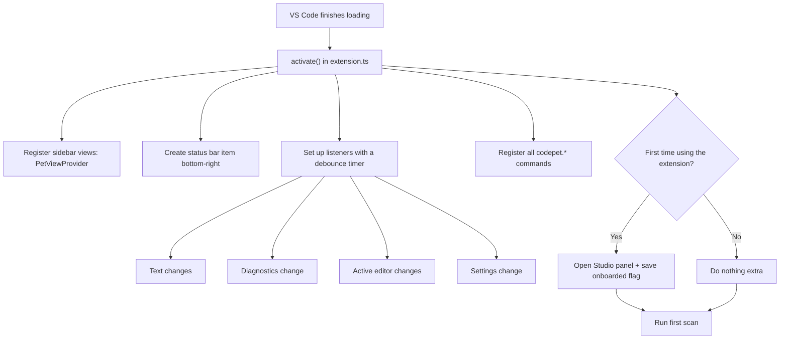

### 4.2 Scanning flow (finding errors)

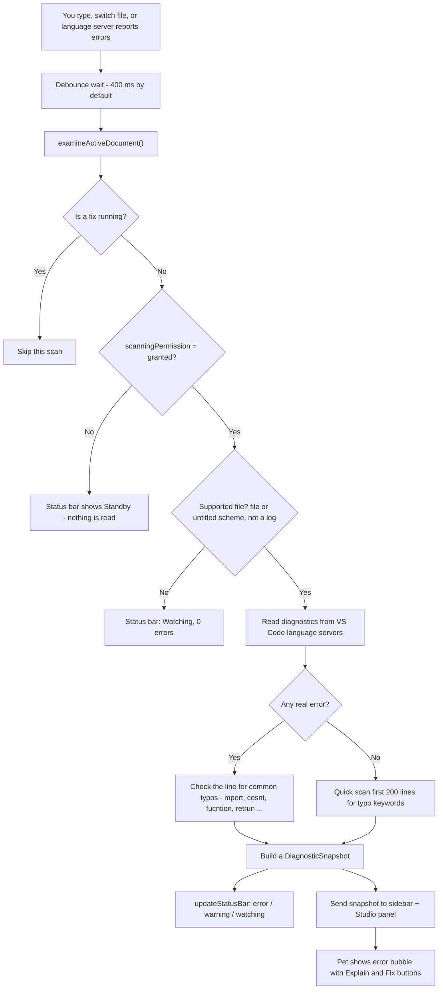

### 4.3 Permission flow

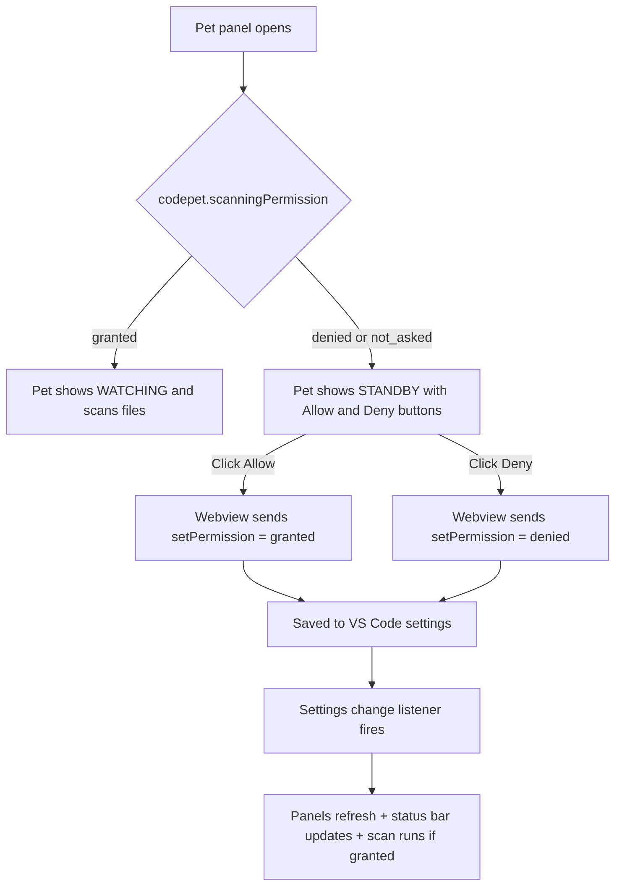

> The default value in `package.json` is `granted`. If you want the pet to **ask first** on a fresh install, change the default to `not_asked`.

### 4.4 "Explain" flow

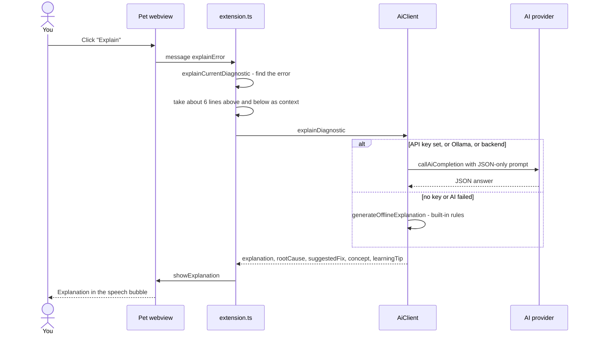

### 4.5 "Fix" flow (the most important flow)

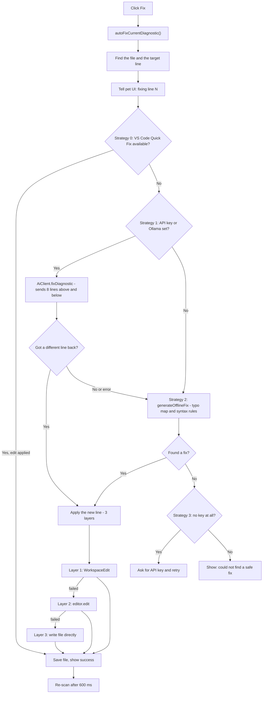

### 4.5.1 Which AI gets called? (`callAiCompletion`)

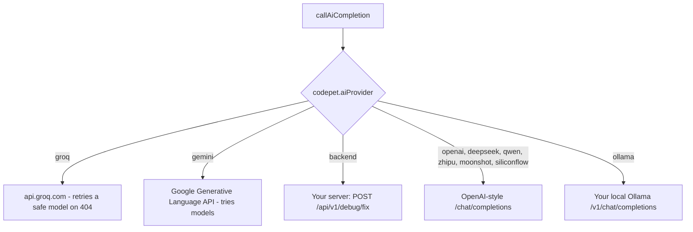

### 4.6 "Generate code" flow (chat box)

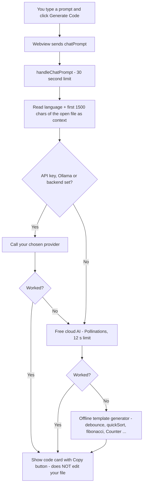

### 4.7 Backend request flow (when provider = backend)

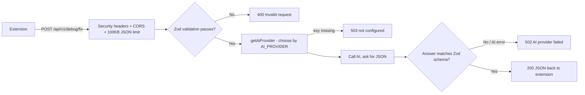

### 4.8 Pet mood changes

**In the extension** (`dottedPet.ts`): `idle`, `watching`, `error`, `warning`, `celebrating`.

**On the website** (`usePetState.ts`): the pet can only move along allowed arrows:

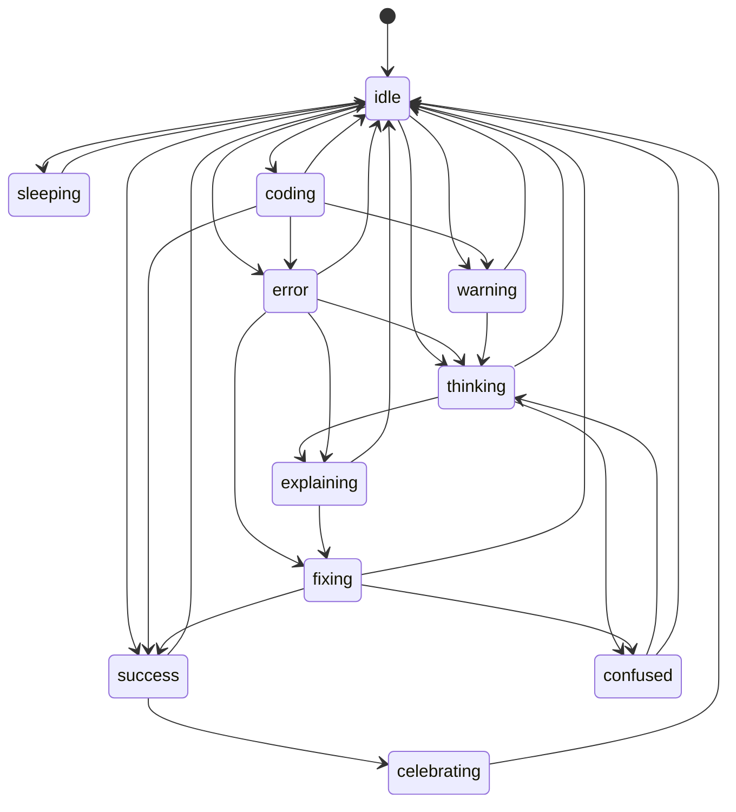

### 4.9 How the webview and the extension talk

The pet panels are **webviews** (small web pages inside VS Code). They cannot call the extension directly, so they send messages.

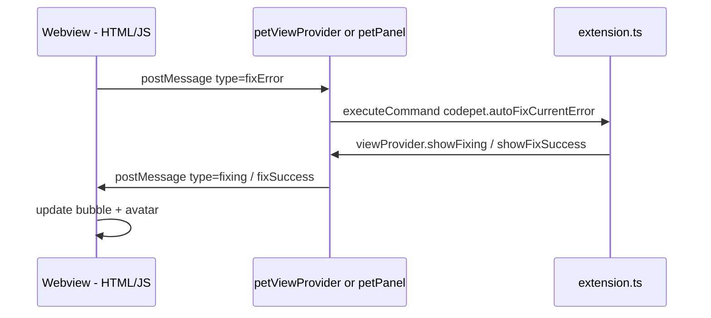

**Messages from the webview → extension**

| Message `type` | What happens |
|---|---|
| `webviewReady` | Run a first scan |
| `setPermission` | Save scan permission, then scan |
| `explainError` / `triggerExplain` | Run Explain |
| `fixError` / `triggerFix` | Run Fix |
| `chatPrompt` | Generate code |
| `copyToClipboard` | Copy generated code |
| `savePet` | Save pet name and species |
| `saveAiConfig` | Save provider, key, model, Ollama URL |
| `testAiConnection` | Test the key (`AiClient.testConnection`) |
| `enterApiKey` | Open the API key input box |
| `openStudio` / `openExternal` | Open Studio / open a web link |

**Messages from the extension → webview:** `diagnostics`, `fixing`, `showExplanation`, `fixSuccess`, `chatGenerating`, `chatResult`, `chatSuccess`, `chatError`, `petUpdated`, `testAiResult`, `configSync`.

### 4.10 How the website works

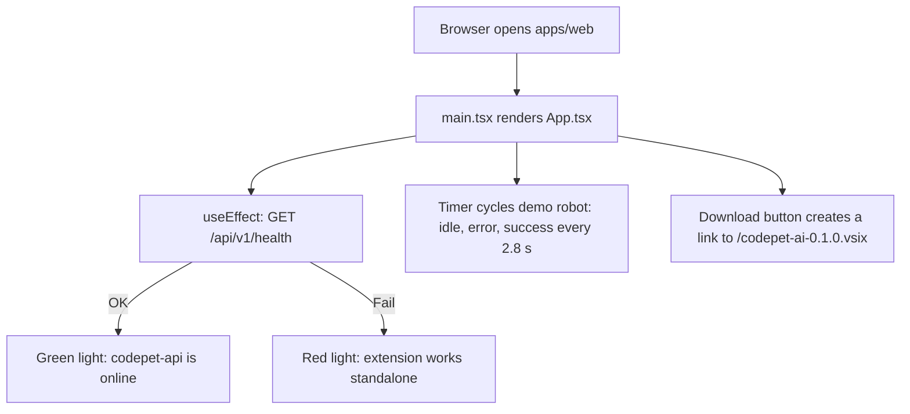

---

## 5. Feature → File → Code map

Use this table to find **where to edit** when you want to change a feature.

| # | Feature | File | Function / code piece (approx. line) |
|---|---|---|---|
| 1 | Start the extension | `extension.ts` | `activate()` (~19) |
| 2 | Sidebar + Explorer pet view | `extension.ts` / `petViewProvider.ts` | `registerWebviewViewProvider(...)` in `activate()`; class `PetViewProvider` |
| 3 | Studio panel beside code | `petPanel.ts` | `PetPanel.createOrShow()` (~41), `getHtml()` (~306) |
| 4 | Status bar (errors / warnings / Watching / Standby) | `extension.ts` | `updateStatusBar()` (~114) |
| 5 | Wait before re-scanning | `extension.ts` | `debounce()` (~704) + setting `codepet.debounceMs` |
| 6 | Scan the current file | `extension.ts` | `examineActiveDocument()` (~140) |
| 7 | Which files are scanned | `extension.ts` | `isSupported()` (~697) |
| 8 | Quick typo detection (`cosnt`, `retrun` ...) | `extension.ts` | typo regex inside `examineActiveDocument()` |
| 9 | Permission-first scanning | `extension.ts` + `petPanel.ts` | `getScanningPermission()`; permission check at top of `examineActiveDocument()`; Allow/Deny buttons (`btnAllow`, `btnDeny`) in `petPanel.ts` |
| 10 | Command: Scan Current File | `extension.ts` | command `codepet.analyzeCurrentFile` |
| 11 | Explain an error | `extension.ts` → `aiClient.ts` | `explainCurrentDiagnostic()` (~254) → `AiClient.explainDiagnostic()` (~446) |
| 12 | Offline explanation | `aiClient.ts` | `generateOfflineExplanation()` (~1039) |
| 13 | One-click Fix | `extension.ts` | `autoFixCurrentDiagnostic()` (~315) |
| 14 | Fix Strategy 0: native Quick Fix | `extension.ts` | `vscode.executeCodeActionProvider` block (~422) |
| 15 | Fix Strategy 1: AI fix | `extension.ts` → `aiClient.ts` | block at ~452 → `AiClient.fixDiagnostic()` (~489) |
| 16 | Fix Strategy 2: offline typo/syntax fixer | `aiClient.ts` | `generateOfflineFix()` (~1091), `typoMap` |
| 17 | Fix Strategy 3: ask for API key | `extension.ts` | block at ~498 → `promptForApiKey()` (~228) |
| 18 | Applying the fix safely (3 layers) | `extension.ts` | block at ~512: `WorkspaceEdit` → `editor.edit` → `workspace.fs.writeFile` |
| 19 | Reading the AI's JSON reply | `aiClient.ts` | `parseAiFixResponse()` (~1446), `extractJson()`, `preserveIndentation()` |
| 20 | Generate code from a prompt | `extension.ts` → `aiClient.ts` | `handleChatPrompt()` (~601) → `AiClient.generateCode()` (~977) |
| 21 | Detect the language in a prompt | `aiClient.ts` | `detectPromptLanguage()` |
| 22 | Free cloud AI fallback (no key needed) | `aiClient.ts` | `callFreeCloudAi()` (~919) |
| 23 | Offline code templates | `aiClient.ts` | `generateOfflineCode()` (~595) |
| 24 | Call the chosen AI provider | `aiClient.ts` | `callAiCompletion()` (~1289) |
| 25 | List of providers + setup guides | `aiClient.ts` | `PROVIDER_GUIDES` (~28) |
| 26 | Pick key / model from settings or env vars | `aiClient.ts` | `getEffectiveConfig()` (~236) |
| 27 | "Test Connection" button | `aiClient.ts` + `petViewProvider.ts` | `AiClient.testConnection()` (~284); message `testAiConnection` |
| 28 | Save API key (hidden input) | `extension.ts` | `promptForApiKey()` – uses `password: true` |
| 29 | Pet name and species | `petViewProvider.ts`, `petPanel.ts` | message `savePet` → saves `codepet.petName` / `codepet.petSpecies` |
| 30 | Draw the pets (bot, cat, dog, dino, fox) | `dottedPet.ts` | `renderPetAvatarSvg()` (~305) → `renderRobotAvatarSvg()` (~15) / `renderDottedPetSvg()` (~112) |
| 31 | Pet reacts to errors | `petViewProvider.ts` | `updateDiagnostics()` (~107), `showFixing()`, `showFixSuccess()`, `showChatError()` |
| 32 | Mute / do-not-disturb setting | `package.json` | setting `codepet.doNotDisturb` and command `codepet.toggleDoNotDisturb` (declared) |
| 33 | Auto mode toggle | `extension.ts` | `autoMode` variable and command `codepet.toggleAutoMode` |
| 34 | Use your own backend as AI | `aiClient.ts` + `server/app.ts` | `provider === "backend"` block (~1386) → `POST /api/v1/debug/fix` |
| 35 | Server input checks | `server/src/ai/contracts.ts` | `debugRequestSchema`, `fixRequestSchema`, `aiAnswerSchema`, `fixAnswerSchema` |
| 36 | Server AI providers | `server/src/ai/provider.ts` | `OpenAiProvider`, `GeminiProvider`, `getAiProvider()` |
| 37 | Server settings check | `server/src/config/env.ts` | `environment` Zod schema |
| 38 | Server security headers | `server/src/app.ts` | `X-Content-Type-Options`, `X-Frame-Options`, `Referrer-Policy` |
| 39 | Login tokens (ready, not used by routes yet) | `server/src/auth/tokens.ts`, `middleware/auth.ts` | `signAccessToken`, `verifyAccessToken`, `requireAuth` |
| 40 | Learning topics and exercises | `server/src/modules/learning.ts` | `topics`, `exercises`, `listTopics`, `listExercises` |
| 41 | Website page | `web/src/App.tsx` | `App()` |
| 42 | Download the `.vsix` | `web/src/App.tsx` | `handleDownload()` + `VSIX_PATH` |
| 43 | API online/offline light | `web/src/App.tsx` | first `useEffect` calling `/api/v1/health` |
| 44 | Website demo robot | `web/src/App.tsx` | `ROBOT_SVG()` + mood-cycling `useEffect` |
| 45 | Website mood rules | `web/src/pet/usePetState.ts` | `allowed` map + `transition()` |
| 46 | Build the `.vsix` file | `vscode-extension/package-vsix.py` | whole script |
| 47 | Debug the extension with F5 | `.vscode/launch.json` + `tasks.json` | "Run CodePet Extension" |

---

## 6. Settings you can change

Open VS Code Settings and search for **CodePet**, or edit them in the Studio panel.

| Setting | Default | Meaning |
|---|---|---|
| `codepet.scanningPermission` | `granted` | `not_asked`, `granted`, or `denied`. Nothing is scanned unless `granted`. |
| `codepet.petName` | `luffy` | Name shown in the UI. |
| `codepet.petSpecies` | `bot` | `bot`, `cat`, `dog`, `dino`, `fox`. |
| `codepet.aiProvider` | `groq` | `groq`, `gemini`, `siliconflow`, `deepseek`, `qwen`, `zhipu`, `moonshot`, `ollama`, `openai`, `backend`. |
| `codepet.apiKey` | empty | Key for the chosen provider. Can also come from env vars like `GROQ_API_KEY`, `GEMINI_API_KEY`. |
| `codepet.aiModel` | empty | Optional model override. Empty means the provider's default. |
| `codepet.ollamaBaseUrl` | `http://localhost:11434` | Where your local Ollama runs. |
| `codepet.apiBaseUrl` | `http://localhost:3001` | Where your CodePet backend runs (for `backend` provider). |
| `codepet.debounceMs` | `400` | Wait time before re-scanning (minimum 200). |
| `codepet.doNotDisturb` | `false` | Hide error notifications. |
| `codepet.autoPopMessages` | `true` | Allow pop-up messages on errors. |

**Commands** (Ctrl/Cmd + Shift + P): Open Companion Beside Editor · Open Studio & Settings · Explain Current Error · Auto-Fix Current Error · Fix Current Error · Configure AI API Key · Scan Current File · Toggle Auto Mode · Toggle Do Not Disturb · Open Settings.

**Free providers and where to get a key**

| Provider | Free? | Key page |
|---|---|---|
| Groq | Yes | https://console.groq.com/keys |
| Google Gemini | Yes (free tier) | https://aistudio.google.com/app/apikey |
| SiliconFlow | Free models | https://cloud.siliconflow.cn/account/ak |
| DeepSeek | Trial credits | https://platform.deepseek.com/api_keys |
| Alibaba Qwen | Free tokens | https://bailian.console.aliyun.com/ |
| Zhipu GLM-4-Flash | Yes | https://open.bigmodel.cn/usercenter/apikeys |
| Moonshot (Kimi) | Free credits | https://platform.moonshot.cn/console/api-keys |
| Ollama | Yes, local, no key | https://ollama.com |
| OpenAI | Paid | https://platform.openai.com/api-keys |

---

## 7. Database design

Defined in `prisma/schema.prisma` (MySQL). The server does **not** use it yet; this is the plan for saving users, pets and learning progress.

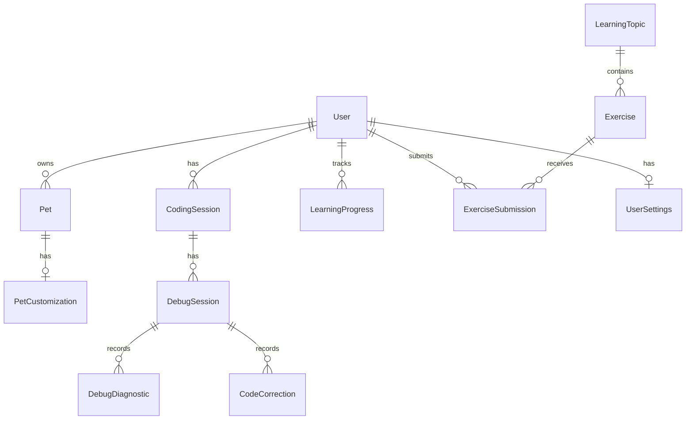

| Table | Purpose |
|---|---|
| `User` | Email and password hash |
| `Pet`, `PetCustomization` | Pet name, species, level, XP, colour, accessory, personality, sounds |
| `CodingSession` | One coding session per language |
| `DebugSession` | One debugging run (mode: MANUAL, SUGGESTION, AUTO) |
| `DebugDiagnostic` | Each error or warning found (file, line, column, message) |
| `CodeCorrection` | Original vs corrected code, confidence, when accepted |
| `LearningTopic`, `Exercise`, `ExerciseSubmission`, `LearningProgress` | Learning centre data |
| `Achievement` | Badges |
| `UserSettings` | Save code history? Debug mode |

---

## 8. How to run the project

**You need:** Node.js 20+, VS Code 1.95+. Docker is optional (only for MySQL).

### Option A – Install the ready-made extension (fastest)

1. Open VS Code → `Ctrl/Cmd + Shift + P` → **Extensions: Install from VSIX...**
2. Pick `apps/vscode-extension/codepet-ai-0.1.0.vsix`.
3. Reload VS Code. The pet appears in the sidebar and the status bar.
4. Open the Studio panel → choose a provider → paste an API key → **Test Connection** → **Save**.

### Option B – Run from source (for developers)

```bash
git clone https://github.com/maimanishhoon/aicodingpet.git
cd aicodingpet
npm install
npm run build --workspace=codepet-ai      # compile the extension
```

Open the folder in VS Code and press **F5**. A test window opens with CodePet running.

### Option C – Run the website and backend

```bash
cp .env.example .env        # then put your key in it, e.g. GEMINI_API_KEY
npm run dev                 # starts server on :3001 and website on :5173
```

Optional database:

```bash
docker compose up -d        # MySQL
npm run db:generate
npm run db:migrate
```

Run the server test: `npm test`

### Build a new `.vsix`

```bash
cd apps/vscode-extension
npm run build
python3 package-vsix.py
```

---

## 9. Security notes

These come from `SECURITY.md` and from the code:

- API keys on the **server** live only in environment variables (`.env`, never committed).
- Server requests are **size-limited** (100 KB) and **validated with Zod**; AI answers are validated too.
- AI prompts tell the model to treat code as **data, not instructions**.
- Server responses include `nosniff`, frame-deny and no-referrer headers.
- Swift code must only be compiled in the **isolated Docker runner** (no network, CPU/memory limits).
- Do not log user source code or keys.
- Before going live, add a reverse proxy with HTTPS, rate limiting and a CSP.

**Things to know as a user:**

- In the extension, `codepet.apiKey` is stored in VS Code **settings** (plain text in `settings.json`), not in the secure secret store.
- If no API key is set, **code generation** falls back to the free Pollinations service (`text.pollinations.ai`). That means your **prompt and up to 1,500 characters of the open file** are sent to a third-party service. Use Ollama or add your own key if you do not want that.

---

## 10. Honest status: what is finished and what is not

This section lists things found while reading every file, so you know what to finish next.

**Working**

- Error watching, status bar, pet reactions, Explain, Fix (with 3 fallbacks), code generation, provider setup, key test, offline fallbacks.
- Backend health, explain and fix routes, learning lists, request validation.
- Landing page with download and API status.

**Written but not connected yet**

| Item | Where | What is missing |
|---|---|---|
| 3D pet drawer | `pet3D.ts` | Nothing imports it. The pets you see come from `dottedPet.ts`. |
| Safe "review before applying" fix | `corrections.ts`, `correctionPanel.ts` | Not called. Right now **Fix** edits and saves the line directly (you can Undo). |
| Do Not Disturb / Auto Mode / pop-up messages | `package.json`, `extension.ts` | The settings `doNotDisturb` and `autoPopMessages` are declared but no code reads them; `autoMode` only flips a flag. The `codepet.toggleDoNotDisturb` command is declared but has no handler registered. |
| Login protection | `auth/tokens.ts`, `middleware/auth.ts` | No route uses `requireAuth`, and there are no register/login routes. |
| Database | `prisma/` | Server never imports Prisma. |
| Learning progress and dashboard | `learning.ts` | Return `503` on purpose. |
| Website `Pet.tsx` and `LearningCentre.tsx` | `apps/web/src` | Not rendered by `App.tsx`. |
| Swift runner | `docker/swift-runner` | No code calls it. |

**Small things to fix**

- The server only accepts `language: "swift" | "javascript"` (`contracts.ts`), but the extension scans every language. When the extension uses the `backend` provider it sends fixed values (`language: "javascript"`, a dummy range), so results are limited.
- The extension never calls `/api/v1/debug/explain`; only `/debug/fix`.
- `codepet.openSettings` filters by `@ext:codepet.codepet-vscode-extension`, but the real ID is `codepet-local.codepet-ai`.
- The pet species in Prisma (`DOG, CAT, PANDA, FOX, ROBOT`) differ from the extension (`bot, cat, dog, dino, fox`).
- `scanningPermission` defaults to `granted`, so the "ask first" popup only appears if you change the default to `not_asked`.
- `aiClient.ts` is very large (about 1,500 lines) because the offline code templates are inside it. Splitting it into `providers.ts`, `offline.ts` and `prompts.ts` would make it easier to maintain.
- Old docs mentioned "3D hovering pets" and "diff review"; the current code uses dotted 2D SVG avatars and direct line fixes.

---

## Tech stack

TypeScript · VS Code Extension API · Node.js · Express · Zod · Pino · JWT · Prisma + MySQL · React 18 · Vite · Framer Motion · Docker · Vitest + Supertest

---

Made with ❤️ by **maimanishhoon**
